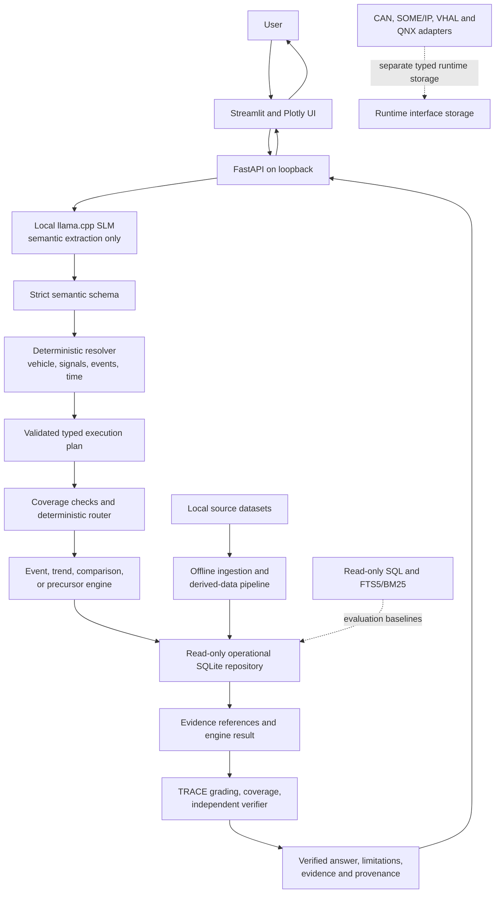

# VehicleGPT / OTTO


**Repository:** [Ahmad-o-Zakariya/vehicle-gpt-otto](https://github.com/Ahmad-o-Zakariya/vehicle-gpt-otto) · **Branch:** `main`

VehicleGPT is an undergraduate research and engineering prototype for asking
natural-language questions about selected vehicle telemetry and receiving
answers tied to inspectable source evidence. It combines a local Small Language
Model (SLM) for query interpretation with deterministic data resolution,
diagnostic engines, and TRACE evidence checks. The SLM does not diagnose the
vehicle, select arbitrary SQL, or write the final answer: it extracts a small
semantic request, while the application resolves a typed plan, runs approved
operations, and verifies the resulting claims.

The project was developed for the TELIPORT Season 4 Vehicle Information case
study. It is intended for research, reproducibility work, and local prototype
evaluation. **It is not a commercially deployed, OEM-certified, safety-rated,
or production vehicle diagnostic system.**

> **Release status:** v0.2.0 is a frozen research prototype with documented
> acceptance limits. Five live SLM case studies passed in CPU mode; GPU
> offload and SLM-generated SQL/RAG baseline comparisons remain unverified.
> Dataset v0.1.0 is conditionally accepted for internal engineering use only.

## Contents

- [Capabilities and validation state](#capabilities-and-validation-state)
- [Architecture](#architecture)
- [Technology](#technology)
- [Repository layout](#repository-layout)
- [Datasets and local data](#datasets-and-local-data)
- [Local SLM](#local-slm)
- [Linux setup](#linux-setup)
- [Run the application](#run-the-application)
- [HTTP API](#http-api)
- [TRACE evidence and verification](#trace-evidence-and-verification)
- [Tests and evaluation](#tests-and-evaluation)
- [Limitations and research scope](#limitations-and-research-scope)
- [Reproducibility and maintenance](#reproducibility-and-maintenance)
- [References and attribution](#references-and-attribution)

## Capabilities and validation state

| Area | Implementation and evidence | Status / boundary |
|---|---|---|
| Natural-language queries | FastAPI `/query` accepts a question and optional selected vehicle. | Five case-study questions passed through local SLM mode. Available domains are intentionally limited. |
| Local SLM planning | Qwen3.5-2B Q4_K_M through llama.cpp; constrained output contains intent, domain, operation, and temporal scope. | CPU inference verified. RTX 3050 GPU offload and VRAM use were not verified in the execution environment. |
| Query resolution | Deterministic resolver binds a selected vehicle, registered signals/events, time window, and engine into a typed plan. | Tested. Unsupported, mismatched, or ungrounded requests fail closed. |
| Diagnostic engines | Event lookup, trend summaries, comparisons, and precursor windows operate on the read-only operational database. | Tested where evidence permits. Precursor case study uses synthetic overlays; no causal inference. |
| Automotive data processing | VED/TUM/OpenLKA/comma2k19 ingestion and DBC decoding support the local research pipeline. | CAN decoding and virtual transport tested. Physical SocketCAN/vcan was blocked by host permissions. |
| Protocol adapters | CAN adapter, SOME/IP JSONL bridge, Android VHAL simulator, and QNX log parser. | SOME/IP, VHAL, and QNX are simulations/fixtures, not live OEM integrations. |
| Evidence-grounded answers | Evidence references, coverage status, deterministic grades, limitations, and an independent verifier. | TRACE grade and adversarial verifier checks passed. |
| User interface | Streamlit and Plotly frontend backed by FastAPI. | Live UI and query flows exercised. No accessibility audit. |
| Baselines | Read-only SQL executor and SQLite FTS5/BM25 retrieval are present. | Manual safety/retrieval checks ran; SLM-generated SQL/RAG comparisons did not. |

The five live case-study results are recorded in the ignored local file
`artifacts/evaluation/slm_case_study.json` when that artifact is available.
Four requests produced verified E0
insufficient-evidence answers. The BMW overheating precursor request produced
E1 evidence from a synthetic development scenario. These are smoke-test results,
not a held-out model benchmark.

## Architecture



### Main subsystems

- **API:** `src/vehicle_gpt/api/app.py` exposes query, typed-plan execution,
  vehicle/capability lookup, event and history access, and evidence resolution.
- **Planner:** `planner/inference.py` calls a loopback llama.cpp endpoint in SLM
  mode. `semantic_schema.py` limits model output to four semantic enums;
  `resolver.py` creates the plan using registered dataset capabilities.
- **Engines:** `engines/` contains deterministic event, trend, comparison, and
  precursor operations. Engines report coverage, evidence, provenance, and
  limitations alongside results.
- **Repository/storage:** `repositories/` resolves operational evidence from a
  read-only SQLite connection. The separate evaluation-only ground-truth store
  is not exposed to query planning or the repository.
- **Runtime adapters:** `adapters/` has CAN decoding, a bounded Unix-socket
  JSONL SOME/IP simulation, a VHAL simulator, and a QNX log parser. Runtime
  messages are stored separately; these adapters do not create a live OEM
  vehicle connection.
- **TRACE:** `trace/` grades evidence, checks coverage, resolves references,
  compares claims with calculations and provenance, and validates the final
  deterministic wording.
- **Evaluation:** `evaluation/baselines/` contains a read-only SQL executor and
  lexical FTS5/BM25 retrieval. These were not compared with SLM-generated
  answers.
- **UI:** `ui/app.py` calls the API and renders the answer, evidence, coverage,
  limitations, and measured history views; engine logic stays server-side.

## Technology

| Purpose | Technologies and pinned versions |
|---|---|
| Runtime and packaging | Python `>=3.14,<3.15`; setuptools; `uv.lock` |
| API and schemas | FastAPI 0.162.0, Uvicorn 0.54.0, Pydantic 2.14.3 |
| UI and charts | Streamlit 1.67.0, Plotly 6.9.0 |
| Data and CAN | SQLite (Python standard library), NumPy 2.5.4, Pandas 3.1.1, PyYAML 6.0.3, python-can 4.6.1, cantools 40.7.1 |
| Local inference | llama.cpp build 12180, commit `bcb015287` (v0.9.0-dev); Qwen3.5-2B Q4_K_M GGUF |
| Development checks | pytest 9.2.0, Hypothesis 6.170.15, Ruff 0.17.4 |
| Large-file checkout | Git LFS; patterns are defined in `.gitattributes` |

There is no root project `LICENSE` file, so this README does not claim a
project-wide license. Dataset and model licensing terms are separate; see
[data handling](#datasets-and-local-data) and [attribution](#references-and-attribution).

## Repository layout

```text
configs/                    Dataset, signal, split, model, and adapter settings
DATASET/                    Selectively tracked source datasets and references
docs/                       Data card, architecture, acceptance, and methods
experiments/                Evaluation scope and experiment notes
manifests/                  Tracked source inventory
models/qwen35-2b/           Qwen3.5-2B GGUF (Git LFS)
scripts/                    Ingestion, validation, launch, and benchmark tools
src/vehicle_gpt/
  adapters/                 CAN, SOME/IP, VHAL, QNX interfaces/simulations
  api/                      FastAPI service and request/response models
  engines/                  Deterministic diagnostic operations
  evaluation/baselines/     Read-only SQL and FTS5/BM25 baselines
  ingest/                   VED, TUM, OpenLKA, and comma2k19 loaders
  planner/                  SLM extraction, semantic resolution, typed plans
  repositories/             Read-only operational evidence access
  runtime/                  Typed runtime messages and separate storage
  trace/                    Evidence grades, coverage, and verification
tests/                      Unit, integration, adapter, and security tests
ui/                         Streamlit and Plotly frontend
```

`data/`, `artifacts/`, Python environments, and caches are local-only and
ignored by Git. The database and evaluation reports described below are not
restored by cloning.

## Datasets and local data

The repository contains a **selective source-data checkout**, not a complete
reproducible data bundle. Large tracked files use Git LFS. The generated `data/`
tree in the development workspace is about 21 GB, but is excluded from Git; a
clone does not contain the operational database, release database, ground-truth
store, or generated evaluation artifacts.

| Source | Present in Git | Use and limits |
|---|---|---|
| VED | Two dynamic `.7z` archives and static registry spreadsheets; large files use LFS. | Selected Nissan Leaf (`VehId=455`) and sparse diesel example (`VehId=119`). Cited to the VED paper. |
| TUM Measurement Data | 70 measurement CSVs, `Overview.xlsx`, and `readin.m`. | BMW i3 trips. Source terms are not included locally and were not independently verified. |
| TUM Simulation Data | 24 CSV and 24 MAT files, tracked selectively (MAT uses LFS). | Kept distinct from measured trips; the operational build does not ingest these as real measurements. |
| OpenLKA | Selected derived failure-sample CSVs and supporting code/docs/images. | State transitions are not reason-coded OEM disengagements. Raw videos, extracted failure-sample media, annotation JSON, and `static/videos/` are excluded. |
| comma2k19 | Repository code/docs and selected support files. | `DATASET/comma2k19-master/Example_1/` is ignored and local-only, including the segment configured for ingestion; raw `video.hevc` is also excluded. The full operational build needs this segment. |

See [dataset overview](docs/DATASET_OVERVIEW.md), [data card](docs/DATA_CARD.md),
[acceptance audit](docs/DATASET_ACCEPTANCE_AUDIT.md), and
[source inventory](docs/dataset_inventory.md) for row counts, provenance,
timestamp semantics, and source-specific terms. In summary, the accepted local
snapshot has 18,279,473 source-derived canonical records across four sources,
plus explicitly separate overlays and derived tables. It is an engineering
dataset, not a fleet-representative diagnostic benchmark.

### What the local database files mean

- `data/processed/vehicle_gpt.sqlite` is the locally generated operational
  database. The API opens it read-only. It is not committed and is not created
  by `uv sync`.
- `data/releases/v0.1.0/vehicle_gpt.sqlite` is a separate, read-only release
  copy. It is also local-only and is not automatically restored by cloning.
- `data/processed/ground_truth/ground_truth.sqlite` and `injections.json` hold
  evaluation labels and injected values separately. Query-time planner,
  repository, and baselines must not read them.
- `artifacts/` holds generated validation, benchmark, and evaluation reports;
  it is ignored and reports must be regenerated locally when needed.

### Build a local operational database

First obtain any missing source files through their maintainers under the
applicable reuse terms. In particular, restore the selected comma2k19 segment
at the path in `configs/datasets.yaml` and `scripts/build_dataset.py`; it is not
in this Git checkout. VED, TUM, and selected OpenLKA inputs are tracked, with
some large assets delivered through LFS.

The supported pipeline ingests sources, builds capabilities, creates explicit
synthetic overlays, and builds derived tables. It uses two-CPU affinity and a
2 GiB virtual-address-space limit (not a resident-memory cap). The pipeline
starts with `--replace`, which deletes an existing generated database and its
SQLite WAL/SHM files. Back up any local database first; do not run this as a
routine setup step or against the frozen release.

```bash
# Only after staging every required source and backing up local data/.
PATH="$PWD/.venv/bin:$PATH" scripts/run_limited.sh scripts/build_pipeline.sh
scripts/run_limited.sh .venv/bin/python scripts/validate_dataset.py
```

The build is offline and writes under ignored `data/`. Review the
[reproducibility guide](docs/REPRODUCIBILITY_GUIDE.md) before rebuilding. There
is no supported command that downloads the missing comma2k19 segment or
restores the prebuilt 21 GB local data tree. Dataset code licenses do not imply
permission to redistribute the underlying measurements.

## Local SLM

The model is `Qwen3.5-2B-Q4_K_M.gguf`, stored at
`models/qwen35-2b/Qwen3.5-2B-Q4_K_M.gguf` through Git LFS. Its expected size is
1,280,835,808 bytes and pinned SHA-256 is
`cbb39d5102a6e6ef9675912b1c21d02335f4374c6bc267faa6cb96d7987d4a7b`.
The original Qwen3.5-2B model is listed as Apache-2.0 in
[`configs/model_candidate.json`](configs/model_candidate.json). The GGUF is a
third-party quantization hosted by Unsloth; review its provenance and applicable
distribution terms before redistribution.

After Git LFS checkout, verify the model:

```bash
sha256sum models/qwen35-2b/Qwen3.5-2B-Q4_K_M.gguf
```

For an alternative fresh checkout where the model path does not exist, the
pinned downloader verifies size and hash, refuses to overwrite an existing
file (including an LFS pointer), and removes an invalid partial download:

```bash
.venv/bin/python scripts/fetch_model.py
```

Install a compatible llama.cpp build that supports this GGUF and expose
`llama-server` on `PATH` or set `LLAMA_HOME`. The tested build is 12180,
commit `bcb015287`. The launcher does not install llama.cpp:

```bash
scripts/run_llama_server.sh
```

Defaults: model path above; host `127.0.0.1`; port `8080`; context size `2048`;
GPU layers `auto`; fit target `768` MiB; parallel slots `1`. The server is
restricted to loopback and does not silently fall back to CPU. To explicitly
select CPU mode, use `LLAMA_GPU_LAYERS=0 scripts/run_llama_server.sh`. The
verified five-case integration used CPU inference; GPU offload, VRAM use, and
target RTX 3050 performance are not verified. See [SLM planner details](docs/SLM_PLANNER.md).

| Variable | Default | Purpose |
|---|---|---|
| `VEHICLEGPT_MODEL_PATH` | `models/qwen35-2b/Qwen3.5-2B-Q4_K_M.gguf` | GGUF path for the launcher. |
| `LLAMA_HOME` | unset | Search location for `llama-server`; otherwise search `PATH` and `~/.local/opt`. |
| `LLAMA_GPU_LAYERS` | `auto` | Offload selection; `0` explicitly requests CPU. |
| `LLAMA_CTX_SIZE` | `2048` | Context length. |
| `LLAMA_FIT_TARGET` | `768` | llama.cpp fit target in MiB. |
| `LLAMA_PARALLEL` | `1` | Parallel server slots. |
| `LLAMA_HOST`, `LLAMA_PORT` | `127.0.0.1`, `8080` | Server bind; non-loopback hosts are rejected. |
| `VEHICLEGPT_LLAMACPP_URL` | `http://127.0.0.1:8080/v1` | Backend's local inference endpoint. |
| `VEHICLEGPT_MODEL_ID` | `qwen3.5-2b-q4_k_m` | Model identifier sent to llama.cpp. |
| `VEHICLEGPT_SLM_TIMEOUT_SECONDS` | `90` | Inference timeout, at most 300 seconds. |

## Linux setup

Requirements: Linux, Git, Git LFS, Python 3.14, `uv`, and standard Linux
`taskset`, `prlimit`, and `awk` commands for bounded dataset operations. Running
SLM mode additionally requires a compatible llama.cpp `llama-server`. The full
database rebuild additionally requires the excluded comma2k19 source segment
and substantial local disk space.

```bash
git lfs install
git clone https://github.com/Ahmad-o-Zakariya/vehicle-gpt-otto.git
cd vehicle-gpt-otto
git lfs pull

python3.14 -m venv .venv
.venv/bin/pip install uv
UV_CACHE_DIR=/tmp/vehicle-gpt-uv-cache .venv/bin/uv sync --locked --extra dev
```

`git lfs pull` retrieves assets tracked by this repository, including the GGUF,
VED archives, and selected MAT/image assets. It does **not** retrieve ignored
files, the 21 GB `data/` tree, or the comma2k19 `Example_1` directory. Follow
[Build a local operational database](#build-a-local-operational-database) only
when you have the missing data and intend to generate local outputs.

## Run the application

The API expects `data/processed/vehicle_gpt.sqlite` at the fixed path in
`src/vehicle_gpt/engines/common.py`. Start the local model server first for SLM
mode, then run the backend and UI in separate terminals:

```bash
# Terminal 1: local llama.cpp service on 127.0.0.1:8080
scripts/run_llama_server.sh

# Terminal 2: FastAPI on 127.0.0.1:8000; omit demo mode for real SLM planning
scripts/run_backend.sh

# Terminal 3: Streamlit on 127.0.0.1:8501
scripts/run_ui.sh
```

Open <http://127.0.0.1:8501>. The frontend talks to
`http://127.0.0.1:8000` by default; override with `VEHICLEGPT_API_URL`. The SLM
client uses `VEHICLEGPT_LLAMACPP_URL` (default
`http://127.0.0.1:8080/v1`), `VEHICLEGPT_MODEL_ID` (default
`qwen3.5-2b-q4_k_m`), and `VEHICLEGPT_SLM_TIMEOUT_SECONDS` (default 90,
maximum 300). Set `VEHICLEGPT_DEMO_MODE=1` on the backend to use the explicitly
labeled deterministic fixture planner instead of llama.cpp:

```bash
VEHICLEGPT_DEMO_MODE=1 scripts/run_backend.sh
```

Example questions (answer availability depends on the selected evidence):

- “Why has driving range reduced over the last two weeks?”
- “When did fuel efficiency show its largest drop?”
- “Show all ADAS disengagement events from yesterday.”
- “What happened in the 60 seconds before the battery overheating warning in the BMW i3?”
- “Compare energy consumption between city and highway driving.”

The first, second, third, and fifth examples currently fail closed with E0 due
to historical coverage, missing validated fuel-efficiency calculations,
unaligned wall-clock time, and absent route-class labels, respectively. The BMW
precursor example is synthetic-only E1 and does not establish causality.

## HTTP API

The service is loopback-only by default. Interactive OpenAPI documentation is
at <http://127.0.0.1:8000/docs> and the schema at
<http://127.0.0.1:8000/openapi.json>.

| Method | Route | Purpose and response |
|---|---|---|
| `GET` | `/health` | Service, read-only DB, vehicle count, planner endpoint and mode; `503` if repository setup fails. |
| `GET` | `/vehicles` | Registered vehicle identities and metadata. |
| `GET` | `/vehicles/{vehicle_id}/capabilities` | Measured signals for a vehicle; `404` for an unknown vehicle or no capabilities. |
| `POST` | `/query` | Natural-language query; JSON body has `question` and optional `vehicle_id`. Returns request ID, semantic output, typed plan, engine result, answer, evidence, and latency. Planner failures return `503`; invalid resolution returns `422`. |
| `POST` | `/execute-plan` | Executes a validated typed plan in a JSON `plan` property; returns the same response structure. Invalid plans return `422`. |
| `GET` | `/events` | Event rows; optional `vehicle_id`, `limit` (1–1000, default 100). |
| `GET` | `/history` | Signal samples; required `vehicle_id` and `signal`, optional `limit` (default 2000). |
| `GET` | `/evidence/{table}/{record_id}` | Resolves an allowed evidence reference; `400` for unsupported table, `404` if absent. |

Example request and response fields:

```bash
curl -sS http://127.0.0.1:8000/query \
  -H 'Content-Type: application/json' \
  -d '{"question":"What happened in the 60 seconds before the battery overheating warning in the BMW i3?","vehicle_id":"tum_bmw_i3:bmw_i3"}'
```

The JSON response includes `planner_mode`, `semantic_query`, `plan`,
`engine_result`, and `answer`. The `answer` contains claims, evidence grade,
coverage, limitations, provenance, and verifier status. `GET /vehicles` and
`/docs` are useful for discovering identities and the full request schema.

## TRACE evidence and verification

TRACE turns deterministic engine output into claims with evidence IDs, units,
calculation references, grades, and limitations. Coverage checks determine
whether the requested vehicle/signal/time window is represented; the verifier
resolves references against the operational store and checks vehicle/trip
identity, timestamp, source, provenance, calculation, unit, grade, synthetic
labeling, causal language, and rendered claim text. The verifier rejects the
complete answer when a check fails. The SLM neither assigns evidence grades nor
generates final free-form diagnostic prose.

Project grades are deterministic support categories: E0 means no supporting
evidence; E1 is partial, insufficient, or synthetic support; E2 is adequate
direct operational support; E3 requires broader multi-trip, multi-signal, and
multi-source evidence under adequate coverage; E− denotes conflicting evidence.
These categories are project rules, not an automotive certification or proof of
causality. See [TRACE details](docs/TRACE_EVIDENCE_SYSTEM.md).

## Tests and evaluation

```bash
# Full regression suite
.venv/bin/python -m pytest -q

# Engine, repository, and hostile-SQL checks
.venv/bin/python scripts/run_system_validation.py

# TRACE grades and adversarial verifier checks
.venv/bin/python scripts/run_trace_validation.py

# Five deterministic development fixtures (not an SLM benchmark)
.venv/bin/python scripts/run_benchmark.py

# Read-only hash, SQLite integrity, foreign-key, and row-count checks
scripts/run_limited.sh .venv/bin/python scripts/verify_release.py

# Focused application lint
.venv/bin/python -m ruff check src/vehicle_gpt/runtime src/vehicle_gpt/adapters src/vehicle_gpt/repositories src/vehicle_gpt/engines src/vehicle_gpt/trace src/vehicle_gpt/planner src/vehicle_gpt/api src/vehicle_gpt/evaluation ui tests scripts/run_slm_case_study.py scripts/run_benchmark.py scripts/run_system_validation.py scripts/run_trace_validation.py
```

The release verifier expects the local, ignored `data/releases/v0.1.0/` tree;
it cannot verify a release that was not restored or built. It is read-only.
Creating a release is a separate maintainer operation and copies the database
and evaluation ground truth into the release bundle; protect that bundle as
internal evaluation data.

For live SLM case studies, start the model and a backend **without** demo mode,
then run:

```bash
.venv/bin/python scripts/run_slm_case_study.py
```

The runner refuses demo mode and saves raw semantic output, validated plans,
TRACE results, evidence, grades, verification state, and latency under ignored
`artifacts/evaluation/`.

Latest recorded results: full regression **52 passed, 1 optional test skipped,
5 subtests passed**; focused Ruff **passed**; system and TRACE validations
**passed**; frozen release verification **passed** all hashes, SQLite integrity,
foreign keys, and row counts. The live SLM run passed all five application
cases. The deterministic fixture benchmark reported 1.0 exact intent, coverage,
and grade agreement across five fixtures; this is not held-out accuracy, SLM
accuracy, or a fair SQL/RAG comparison. Details are in
[`docs/TESTING_AND_VALIDATION.md`](docs/TESTING_AND_VALIDATION.md) and the
[final acceptance report](docs/FINAL_SYSTEM_AUDIT.md).

## Limitations and research scope

- **Data coverage:** VED spans 2017–2018; TUM measurements span 2019–2020;
  OpenLKA and comma2k19 use source-specific time bases. “Last two weeks” and
  “yesterday” cannot be answered as current wall-clock facts from these records.
- **Fuel efficiency:** fuel rate is not fuel efficiency, and the data does not
  support a validated aligned consumption-per-distance largest-drop calculation.
- **ADAS:** OpenLKA samples expose controller-state transitions, not OEM
  disengagement reasons. Several timestamps are repeated or clip-relative.
- **Thermal precursor:** the BMW warning, pump-duty signal, and precursor
  overlays are synthetic test fixtures. Temporal order is not causal evidence;
  no measured OEM overheating event is established.
- **Route comparison:** the operational data has no verified city/highway labels
  or matched route segments; speed alone is not used to infer those classes.
- **Integrations:** CAN DBC decode and virtual transport were tested; SocketCAN
  access was unavailable. SOME/IP, Android VHAL, and QNX are simulated or
  parser-fixture integrations, not live in-vehicle systems.
- **Model and baselines:** CPU inference was verified; GPU offload, VRAM, and
  target hardware performance were not. SLM-generated SQL/RAG comparisons,
  held-out metrics, and causal experiments were not run.
- **Dataset rights:** TUM and comma2k19 data reuse terms were not independently
  verified. OpenLKA data terms are separate from its MIT code/DBC license; raw
  video is not redistributed. Confirm each data source's terms before sharing.
- **Runtime and security:** Python 3.11 compatibility and ARM target behavior
  remain unverified. The current project metadata targets Python 3.14. This
  local prototype has not undergone production security, safety, or accessibility
  certification.

See [acceptance limits](docs/FINAL_SYSTEM_AUDIT.md),
[dataset quality](docs/DATA_QUALITY_REPORT.md), and the
[question coverage matrix](docs/QUESTION_COVERAGE.md).

## Reproducibility and maintenance

Use `uv.lock` and the recorded model/config revisions to reproduce the local
environment. Dataset source files are selectively tracked; generated databases
and release copies are local artifacts. Keep the accepted v0.1.0 release
read-only, preserve source checksums/manifests, and do not run the build pipeline
against a frozen release. `scripts/run_limited.sh` constrains CPU affinity and
virtual address space for offline build/verification commands.

Useful inspection commands (read-only):

```bash
.venv/bin/python scripts/inspect_dataset.py summary
.venv/bin/python scripts/inspect_dataset.py vehicles
.venv/bin/python scripts/inspect_dataset.py signals --vehicle tum_bmw_i3:bmw_i3
.venv/bin/python scripts/inspect_dataset.py quality
```

For contribution scope and implementation details, see
[protocol adapters](docs/PROTOCOL_ADAPTER_ARCHITECTURE.md),
[UI/API architecture](docs/UI_ARCHITECTURE.md),
[evaluation methodology](docs/EVALUATION_METHODOLOGY.md), and
[work state](docs/WORK_STATE.md).

## References and attribution

- **VED:** Geunseob Oh, David J. LeBlanc, and Huei Peng, “Vehicle Energy
  Dataset (VED), A Large-scale Dataset for Vehicle Energy Consumption
  Research,” *IEEE Transactions on Intelligent Transportation Systems*, 2020.
  [DOI](https://doi.org/10.1109/TITS.2020.3035596) ·
  [local source README](DATASET/VED-master/README.md). The included source
  archive has Apache-2.0 terms; retain attribution.
- **TUM BMW i3:** [IEEE DataPort dataset, DOI 10.21227/6JR9-5235](https://doi.org/10.21227/6JR9-5235).
  No local terms file was found; verify reuse conditions.
- **comma2k19:** [comma.ai dataset repository](https://github.com/commaai/comma2k19)
  and [local README](DATASET/comma2k19-master/README.md). The repository code
  has an MIT license; separate rights for data should not be inferred.
- **OpenLKA:** [Wang et al., OpenLKA paper](https://arxiv.org/abs/2505.09092),
  [project and data terms](https://openlka.github.io/), and
  [local source README](DATASET/OpenLKA-main/README.md). Cite the paper and do
  not redistribute raw video.
- **Qwen:** [Qwen3.5-2B model card](https://huggingface.co/Qwen/Qwen3.5-2B).
  Pinned GGUF distribution: [Unsloth Qwen3.5-2B-GGUF](https://huggingface.co/unsloth/Qwen3.5-2B-GGUF/tree/b6d78642766d0457789548ee826aaf8a4306b14f).
- **llama.cpp:** [ggml-org/llama.cpp](https://github.com/ggml-org/llama.cpp).
- **Software libraries:** [FastAPI](https://fastapi.tiangolo.com/),
  [Streamlit](https://docs.streamlit.io/),
  [Pydantic](https://docs.pydantic.dev/), and
  [python-can](https://python-can.readthedocs.io/).

Source-code licenses do not grant blanket permission to redistribute datasets,
media, or derived records. Dataset acceptance remains conditional and internal;
review upstream terms before external use.

---

**Project status:** VehicleGPT / OTTO v0.2.0 is a frozen research engineering
prototype. It demonstrates local semantic planning, deterministic evidence
processing, and independent response verification under the documented limits
above. It is not production-ready, OEM-certified, or validated for use in real
vehicles. The frozen dataset and acceptance report are the reproducibility
boundary for this release.
