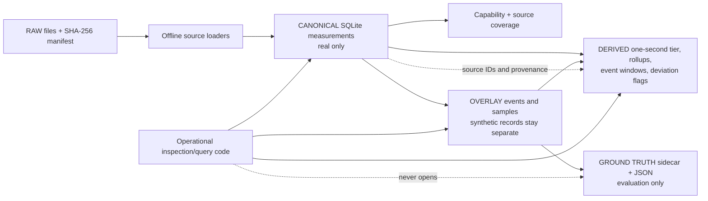
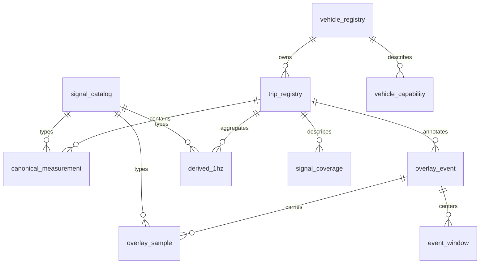
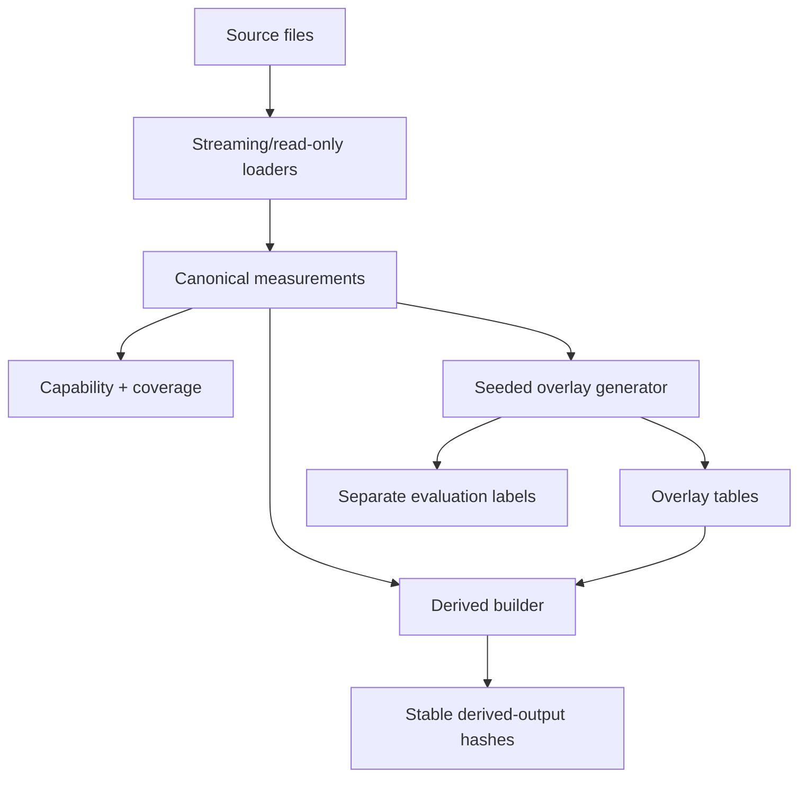

# Dataset Architecture

## Five layers

| Layer | Location | Contents |
|---|---|---|
| RAW | `DATASET/` and `data/manifests/raw_files.json` | Immutable supplied files, size and SHA-256 |
| CANONICAL | `data/processed/vehicle_gpt.sqlite` | Long-format source measurements; `provenance='real'` only |
| OVERLAY | Main DB `overlay_event`, `overlay_sample` | Real observed OpenLKA state changes and separately labelled synthetic events/samples |
| GROUND TRUTH | `data/processed/ground_truth/ground_truth.sqlite`, `injections.json` | Injection parameters, values, labels, and split; evaluation-only |
| DERIVED | Main DB `derived_1hz`, `trip_rollup`, `event_window`, `deviation_flag` | Deterministic, rebuildable outputs from canonical plus overlay |

## Operational and evaluation separation

The operational database has no `injection`, `injection_signal`, or
`split_manifest` tables. Synthetic overlay rows carry an injection ID and are
validated against the sidecar. `scripts/inspect_dataset.py` cannot show
evaluation labels unless `--evaluation-only` precedes the
`evaluation-injections` command. No operational source module imports the
ground-truth database.

## Main database relationships

The exact columns, nullability, key order, and foreign keys are in the generated
[data dictionary](DATA_DICTIONARY.md). Signal units are normalized in
`signal_catalog`; source units and original lexical values are retained on each
canonical row.

## Capability and data flow

`vehicle_capability` describes only observed canonical signals for each vehicle.
`signal_coverage` describes availability and missingness per trip/signal.
Synthetic-only signals do not create measured capabilities. A signal request
without a capability row must be treated as insufficient evidence.

Replay rules, conversions, and no-interpolation policy are documented in
[derived method](derived_method.md) and [capability coverage](capability_coverage.md).
