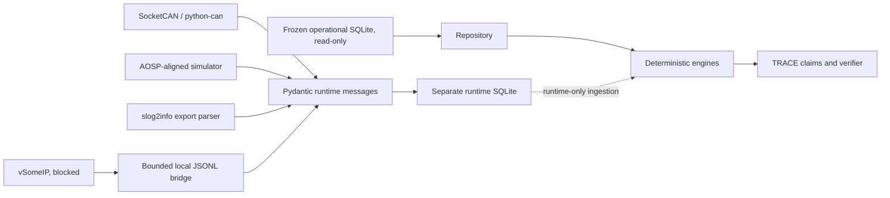

# Protocol Adapter Architecture

Protocol messages use `src/vehicle_gpt/runtime/messages.py` and are appended to
`data/runtime/runtime.sqlite`, never to the frozen canonical DB or release.
Every record retains vehicle/trip identity, protocol, source/replay timestamp,
provenance, quality flag and typed payload. Operational queries open the frozen
DB with SQLite `mode=ro`, `query_only=ON`, and `trusted_schema=OFF`.

**Boundary:** python-can virtual transport and the VHAL simulator are explicit
simulators. Neither is represented as a live vehicle interface. Native vSomeIP
and privileged vcan setup are environment-blocked; see [SOME/IP](SOMEIP_ADAPTER.md)
and [CAN](CAN_ADAPTER.md).
